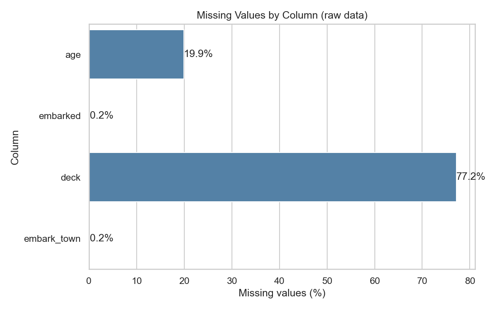
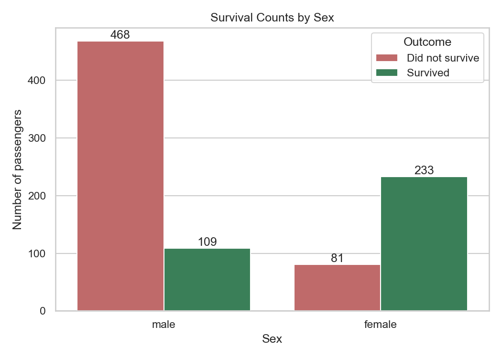
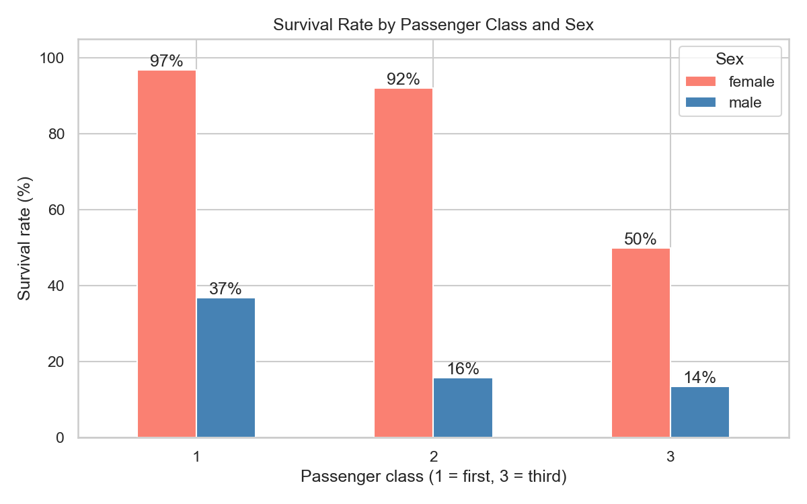
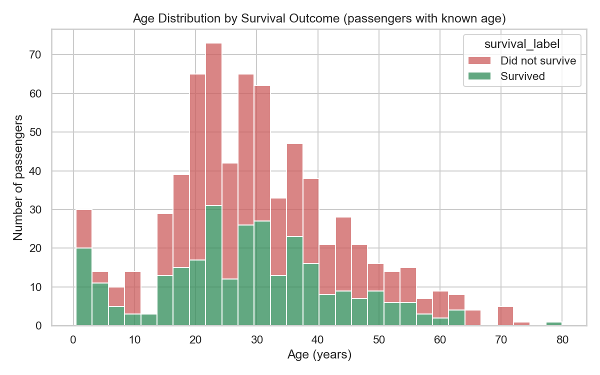
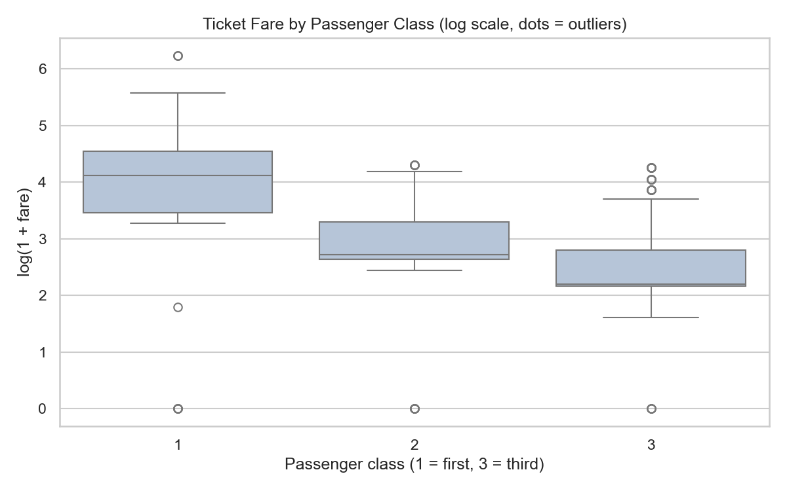
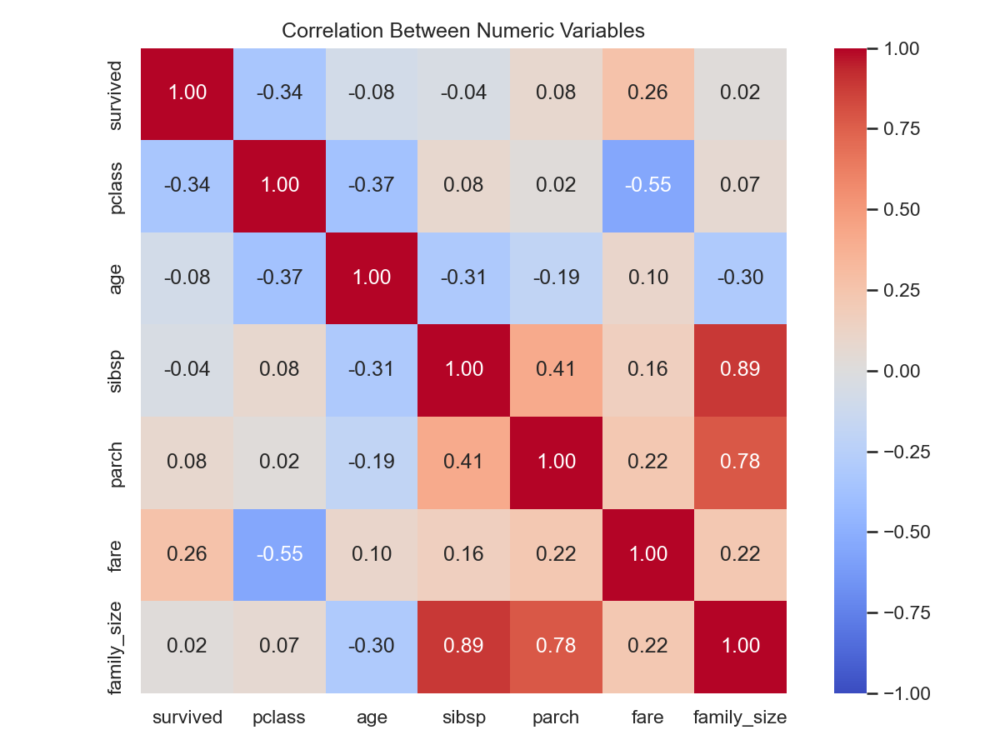
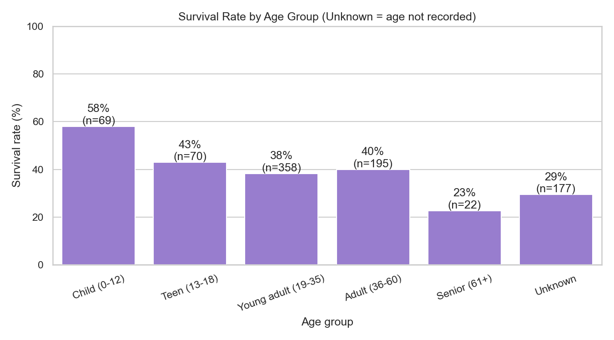
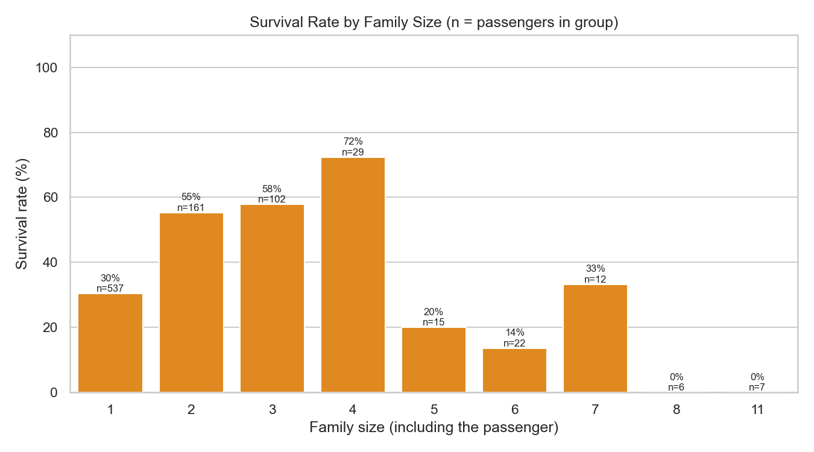

# CodeAlpha_Exploratory_Data_Analysis

Exploratory Data Analysis (EDA) of the Titanic passenger dataset.
Task 2 of the CodeAlpha Data Analytics Internship.

## Objective
Explore a real dataset step by step: check its structure and quality, clean it with
clear reasons, compare groups, study distributions, outliers and correlations, and
report findings that come directly from the data.

## Dataset
- **Titanic passengers**, 891 rows, 15 original columns.
- Source: the public [seaborn-data](https://github.com/mwaskom/seaborn-data) repository (`titanic.csv`).
- This is a well-known **demonstration (teaching) dataset**. It is real historical data,
  but it is not a current business dataset.
- A copy is stored in `data/raw/titanic.csv`. If it is missing, `eda.py` downloads it.

## Research questions
1. How complete is the data (missing values, duplicates)?
2. What was the overall survival rate?
3. Did survival differ by sex?
4. Did survival differ by passenger class (and by class and sex together)?
5. Did age matter?
6. Did family size matter?
7. What do ticket fares look like, and are there outliers?
8. Which numeric variable has the strongest linear link with survival?

## Tools
Python, Pandas, NumPy, Matplotlib, Seaborn (VS Code)

## Project structure
```
CodeAlpha_Exploratory_Data_Analysis/
├── eda.py                      # the full analysis
├── requirements.txt
├── .gitignore
├── README.md
├── data/
│   ├── raw/titanic.csv         # original data
│   └── processed/titanic_clean.csv   # created by eda.py
├── charts/                     # 8 PNG charts, created by eda.py
└── reports/
    ├── findings.md             # findings calculated from the data
    └── eda_report.txt          # the full printed output
```

## How to run (Windows, VS Code terminal)
```
python -m venv venv
.\venv\Scripts\Activate.ps1
python -m pip install -r requirements.txt
python eda.py
```

## Methodology
1. Load the data and inspect shape, data types and descriptive statistics.
2. Check missing values and duplicates. Duplicates are reported but not removed, with the reason explained.
3. Clean: keep the original `age`, add `age_filled` (median by class and sex) and an `age_missing` flag;
   label missing `deck` as "Unknown"; fill the 2 missing `embarked` values with the most common value.
4. Create helper columns (`family_size`, `age_group`, `survival_label`) and flag fare outliers with the IQR rule. Outliers are kept.
5. Compare survival across sex, class, age group, port, family size and travelling alone.
6. Create 8 charts and calculate a correlation matrix.
7. Write findings automatically from the calculated numbers.

## Results
All findings are calculated by `eda.py` from the data and saved in
[`reports/findings.md`](reports/findings.md). The full printed output is in `reports/eda_report.txt`.

## Charts









## Limitations
- Demonstration dataset, not a current business problem.
- A large part of `age` and most of `deck` are missing, so results using them rely on a subset.
- The data has no passenger names or ticket numbers, so duplicate rows cannot be verified.
- Group differences and correlations show association, not cause and effect.
- Small groups (such as large families) give unstable percentages.
